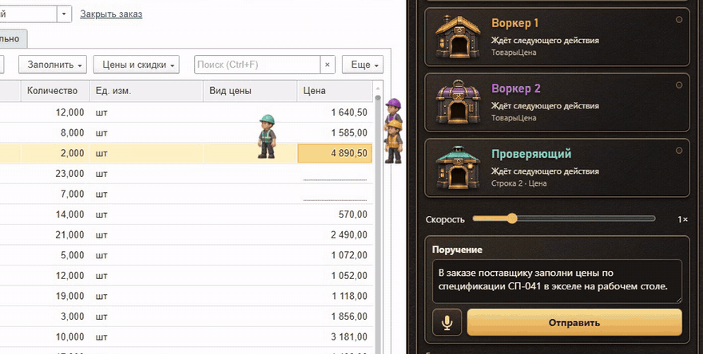
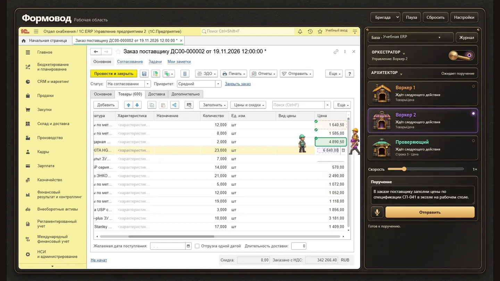
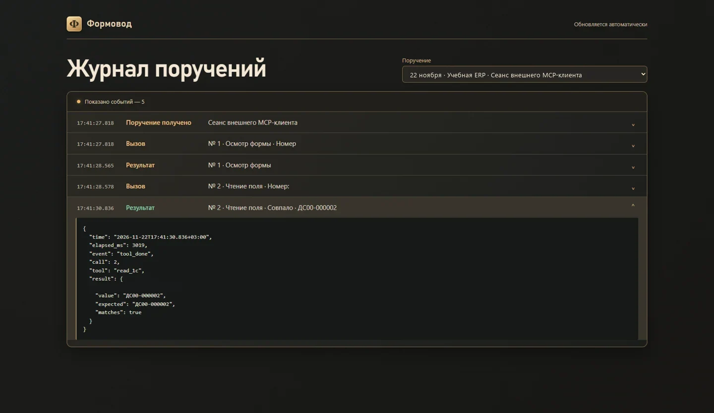
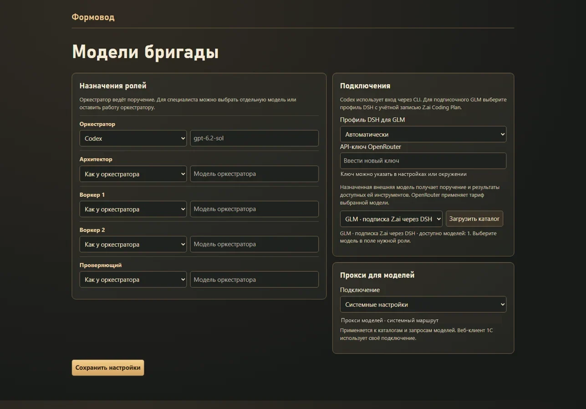

# Формовод — визуальный MCP для 1С

**Модель работает в форме 1С. Оператор видит её действия, сверяет результат и может остановить поручение.**

[](https://github.com/andromanpro/formovod/releases/tag/v0.8.1)
[](#совместимость-клиентов)
[](#совместимость-клиентов)

**[Скачать для Windows](https://github.com/andromanpro/formovod/releases/download/v0.8.1/Formovod-0.8.1-Windows.zip)** · [Смотреть демонстрацию](#как-это-выглядит) · [Первый запуск](<docs/Пилот Windows.md>) · [Инструменты MCP](app/README.md)

[Сайт автора](https://androman.pro) · [Telegram](https://t.me/andromanpro1c)

Формовод работает с элементами открытой формы веб-клиента 1С. Модель может найти команду по подписи, перейти к нужной вкладке, заполнить поле или строку таблицы и перечитать результат. Те же инструменты используются в справочниках, документах и отчётах. Доступные действия зависят от конкретной формы и прав пользователя.

## Как это выглядит



На записи из учебной ERP видно, как один воркер вводит значение, пока проверяющий перечитывает соседнюю ячейку. [Полный 20-секундный дубль](https://github.com/andromanpro/formovod/releases/download/v0.8.0/Formovod-SP-041-demo.mp4) · [Примеры поручений и файлы Excel](examples/)

## Как устроено наблюдение


Оркестратор ведёт поручение, архитектор показывает план, воркеры работают с формой, проверяющий перечитывает результат. Роли можно назначать разным моделям. В одной форме ввод идёт по очереди через активный редактор, а чтение завершённой строки может идти параллельно с подготовкой следующего ввода.

- **На экране.** Воркеры подходят к конкретной кнопке или ячейке. Проверяющий показывает прочитанное значение и результат сравнения. Скорость анимации настраивается.
- **Остановка.** Кнопка прерывает поручение и очередь ввода. Уже отправленное в 1С действие может успеть выполниться. Форма остаётся открытой для проверки.
- **Журнал.** Можно открыть поручение и посмотреть вызовы, результаты и снимки, если они запрашивались. Локальный журнал помогает разобрать, что именно произошло.

<details>
<summary>Рабочая область, журнал и распределение моделей</summary>







</details>

## Запуск и подключение

Откройте [Start-Formovod.cmd](Start-Formovod.cmd). Первой появляется форма «Выберите базу 1С». Она читает локальные конфигурации Apache и IIS, веб-адреса из списка запуска 1С и сохранённые подключения. Статус «Доступна» означает, что сервер отдал страницу веб-клиента 1С. Выберите строку и нажмите «Подключить». Можно также указать веб-адрес вручную. В выбранной базе используется ваш обычный вход.

В верхней части пульта **База → Обновить список публикаций** повторяет поиск. **Добавить базу…** позволяет сохранить название и адрес вручную. **Подключить** переключает цель MCP, предыдущая вкладка сохраняет открытые формы. Между базами переключаются после завершения или остановки поручения. Параметр `--url` открывает указанную публикацию напрямую. Для отдельных экземпляров Apache, которые запускаются вручную, в `%APPDATA%/Formovod/apache-configs.txt` можно перечислить пути к конфигурациям, по одному в строке. Тогда их публикации видны и после остановки сервера.

Кнопка **Журнал** открывает список поручений, включая сеансы внешнего MCP-клиента. Раскройте событие, чтобы увидеть параметры, результат действия или снимок, если модель его запросила. Текстовые данные хранятся локально в JSONL, снимки — в соседней папке поручения. Журналы прежних версий открываются с тем составом сведений, который был записан тогда.

**Настройки → Модели, роли и прокси** открывает назначения оркестратора, архитектора, двух воркеров и проверяющего. Изначально работу всех ролей ведёт Codex. Можно назначить специалисту отдельную модель Codex, подписочный GLM через DSH или модель OpenRouter. Там же меняется сетевой маршрут для моделей. Карточки руководителей при открытии свёрнуты. Для локальной и браузерной диктовки включена автоотправка по завершении фразы.

### Совместимость клиентов

Пилот 0.8 подключается к веб-публикациям 1С в Chromium под Windows. Прогоны с редактированием проверены в учебной 1С:ERP. На другой конфигурации начните с поручения на чтение и проверьте, какие элементы конкретной формы распознаёт MCP. Адаптер для Firefox отсутствует. Подключение тонкого клиента пока исследуется на отдельном прототипе с TestPilot.

```powershell
.\Start-Formovod.cmd --url "https://your-server/erp/ru_RU/" --inbox "D:\Входящие"
```

### Установка из исходников

Нужны Python 3.14 и доступ к веб-клиенту 1С. Для исходной схемы ролей войдите в Codex CLI. Для GLM используется установленный DSH с подпиской Z.ai, для OpenRouter — ключ API. Команды запускаются из корня проекта.

```powershell
py -3.14 -m venv .venv
.\.venv\Scripts\python.exe -m pip install -r requirements.txt
.\.venv\Scripts\python.exe -m playwright install chromium
.\Start-Formovod.cmd
```

CMD выбирает интерпретатор проекта. Для доступа из внешнего MCP-клиента есть [пример конфигурации stdio](examples/mcp/formovod.toml). При переносе на другой компьютер укажите в нём местные пути `command` и `cwd` и адрес публикации. Для отдельного браузера предусмотрены `--chromium` и `FORMOVOD_CHROMIUM`.

Поле поддерживает исправление надиктованного текста, ручную отправку и автоотправку. В настройках диктовки можно выбрать способ распознавания и скачать локальный Whisper с моделью Tiny, Base или Small. Используемый распознаватель, модель и путь к журналу видны в настройках. По умолчанию журнал каждого поручения сохраняется в `%APPDATA%\Formovod\logs`. Подробности о голосе, источнике Excel, видимых элементах и способах подключения приведены в [руководстве по MCP](app/README.md).

Пока поручение выполняется, в правой панели доступна кнопка **Остановить поручение**. Она прекращает работу модели и очередь ввода. Окно 1С остаётся открытым. В итоге видны завершённые вводы, сверки, отмеченные моделью пропуски, ошибки попыток и прерванные действия. Уже отправленный в 1С щелчок или символ может успеть сработать. Проверьте открытый редактор перед продолжением. Следующее поручение запускается обычной кнопкой отправки.

Для пилота на другом компьютере есть установщик `Install-Formovod.cmd`, диагностика `Start-Formovod.cmd --check` и вывод местной конфигурации `--print-mcp`. Обе команды принимают адрес публикации и путь к входящей папке. Комплект собирается командой `py -3.14 qa/build_pilot.py <каталог-поставки>`. [Инструкция для оператора](<docs/Пилот Windows.md>)

В правой панели раскройте **Оркестратор** или **Архитектор**, чтобы увидеть рабочее место персонажа. Движением управляют скорость и кнопка паузы. В **Настройках** можно включить линии от работников к целям.

## Карта проекта

| Каталог | Содержимое |
|---|---|
| [app](app/) | Сервер MCP, панель, адаптеры моделей и графика бригады |
| [qa](qa/) | Проверки работы интерфейса, журнала, запуска и маршрутов моделей |
| [examples](examples/) | Примеры поручений и учебные файлы Excel |
| [docs](docs/) | Инструкция оператора, снимки и исходники схем |


## Автор и контакты

Роман Андриянов

[androman.pro](https://androman.pro) · [Telegram](https://t.me/andromanpro1c) · [Задачи и предложения](https://github.com/andromanpro/formovod/issues)
